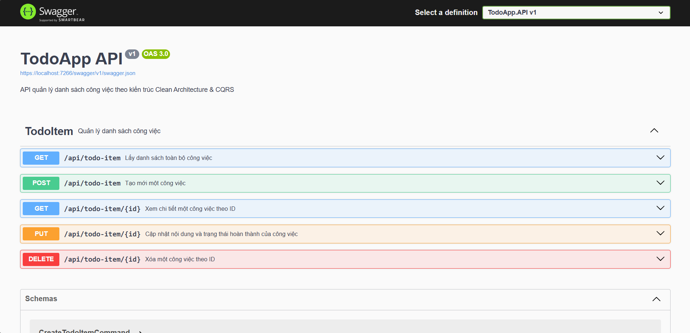
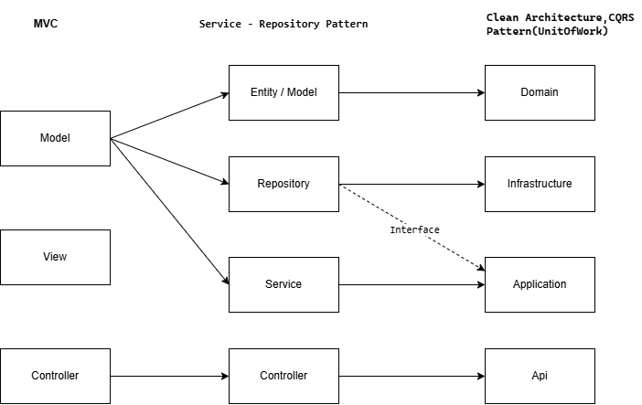
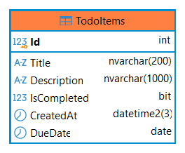

# TodoApp API (.NET 8 — Clean Architecture, CQRS & Unit of Work)

Dịch vụ Backend RESTful API quản lý danh sách công việc được xây dựng trên **.NET 8**, áp dụng **Clean Architecture 4 tầng**, **Lightweight CQRS**, **Repository & Unit of Work** và **EF Core Database First** với **SQL Server 2022 (Docker)**.



---

## Công nghệ sử dụng

- **Framework:** .NET 8 / ASP.NET Core Web API (C# 12)
- **ORM:** Entity Framework Core `8.0.34` (Database First)
- **Database:** Microsoft SQL Server 2022 (`Docker Compose`)
- **API Docs:** Swashbuckle Swagger / OpenAPI 3.0 (tích hợp XML Documentation Comments)
- **Bảo mật cấu hình:** `.env` (Docker) & `.NET User Secrets`

---

## Kiến trúc hệ thống

Solution `TodoApp.slnx` chia thành 4 project theo đúng quy tắc phụ thuộc hướng vào lõi (**Dependency Rule**):

| Project | Vai trò |
| :--- | :--- |
| **`TodoApp.Domain`** | Thực thể lõi (`TodoItem`), không phụ thuộc thư viện ngoài |
| **`TodoApp.Application`** | CQRS `Commands` / `Queries`, `TodoItemDto`, và hợp đồng `ITodoItemRepository`, `IUnitOfWork` |
| **`TodoApp.Infrastructure`** | Triển khai EF Core (`TodoAppDbContext`, `TodoItemRepository`, `UnitOfWork`) đóng gói bằng `internal sealed` |
| **`TodoApp.API`** | RESTful Controller (`TodoItemController`), Swagger và Composition Root (`Program.cs`) |



---

## Cơ sở dữ liệu & Bộ API

### Bảng `dbo.TodoItems`



### Danh sách Endpoints (`/api/todo-item`)

| Method | Endpoint | Mô tả | Mã phản hồi |
| :---: | :--- | :--- | :--- |
| `GET` | `/api/todo-item` | Lấy danh sách toàn bộ công việc (`AsNoTracking`) | `200 OK` |
| `POST` | `/api/todo-item` | Tạo mới một công việc | `201 Created`, `400 Bad Request` |
| `GET` | `/api/todo-item/{id}` | Xem chi tiết công việc theo ID | `200 OK`, `404 Not Found` |
| `PUT` | `/api/todo-item/{id}` | Cập nhật nội dung và trạng thái `IsCompleted` | `200 OK`, `400`, `404 Not Found` |
| `DELETE` | `/api/todo-item/{id}` | Xóa công việc theo ID | `204 No Content`, `404 Not Found` |

---

## Hướng dẫn chạy dự án (Quick Start)

### 1. Khởi chạy SQL Server bằng Docker Compose
```powershell
Copy-Item .env.example .env
# Mở file .env và điền mật khẩu mạnh cho MSSQL_SA_PASSWORD

docker compose up -d mssql
```

### 2. Khởi tạo bảng & nạp dữ liệu mẫu
Kết nối vào SQL Server (`127.0.0.1,1433`, user `sa`) và chạy lần lượt:
- [`database/init.sql`](./database/init.sql) — Tạo `TodoAppDB`, bảng `dbo.TodoItems` và 2 bản ghi mẫu ban đầu.
- [`database/seed-50-items.sql`](./database/seed-50-items.sql) *(tùy chọn)* — Nạp thêm 50 bản ghi mẫu tiếng Việt.

### 3. Cấu hình chuỗi kết nối bằng User Secrets
```powershell
dotnet user-secrets set "ConnectionStrings:TodoApp" "Server=127.0.0.1,1433;Database=TodoAppDB;User Id=sa;Password=<MAT_KHAU_SA>;Encrypt=True;TrustServerCertificate=True" --project TodoApp.API
```

### 4. Chạy API & Mở Swagger UI
```powershell
dotnet run --project TodoApp.API
```
Mở trình duyệt tại `https://localhost:7266/swagger` (hoặc `http://localhost:5110/swagger`).

---

## Tài liệu chi tiết trong dự án

- [Báo cáo Sản phẩm Demo & Ảnh chụp kiểm thử](./docs/project-report.md)
- [Tài liệu Kiến trúc Hệ thống](./docs/arch.md)
- [Hướng dẫn EF Core Database First & Scaffold](./docs/database-first.md)
