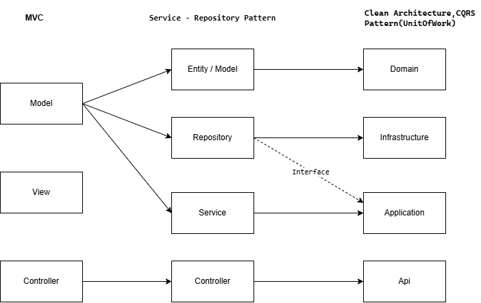
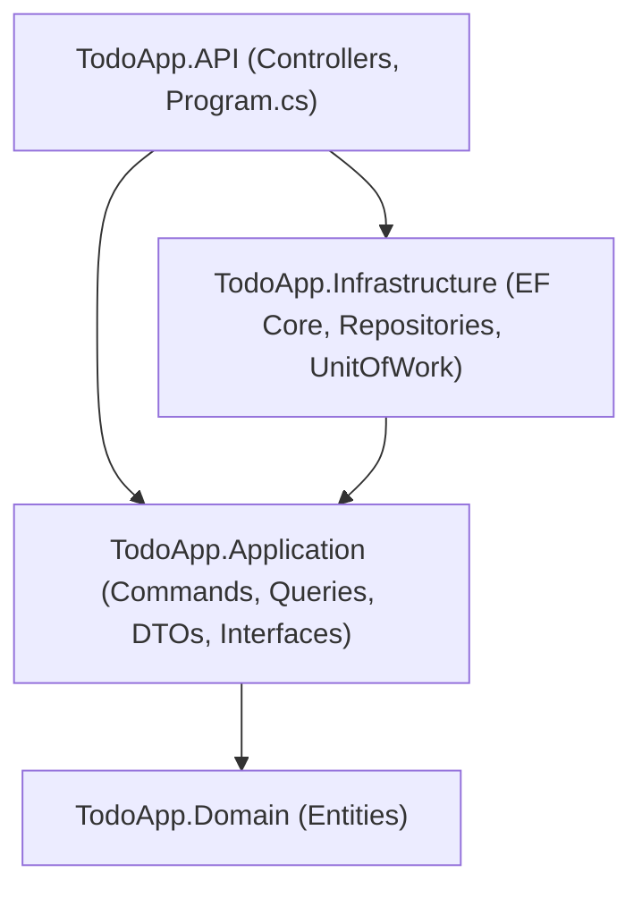
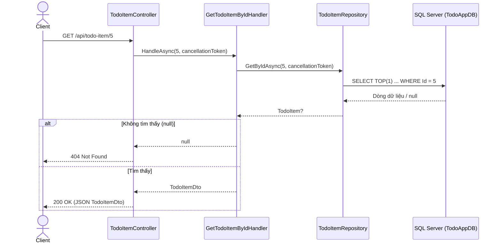
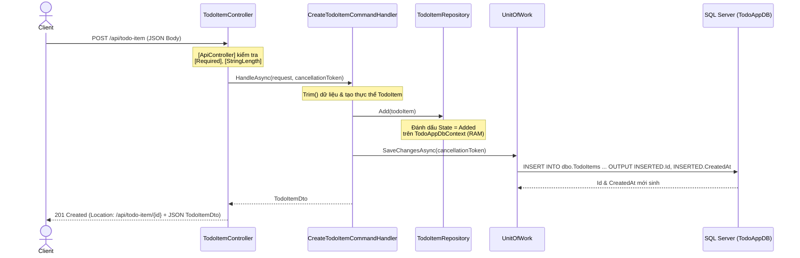

# Kiến trúc Hệ thống TodoApp trên .NET 8

`TodoApp` là dịch vụ Web API quản lý danh sách công việc trên nền tảng **.NET 8** và **SQL Server 2022**, được tổ chức theo hướng **Clean Architecture (Kiến trúc Sạch)** kết hợp **Lightweight CQRS** (phân tách Đọc/Ghi không phụ thuộc thư viện trung gian) và tiếp cận **EF Core Database First**.

---

## 1. Sơ đồ Ánh xạ & Cấu trúc Tổng thể Solution

Kiến trúc 4 tầng của `TodoApp` được hình thành từ quá trình phân rã trách nhiệm từ mô hình **MVC** truyền thống qua **Service - Repository Pattern** sang **Clean Architecture + CQRS (UnitOfWork)**:



*(Xem bài phân tích chi tiết từng nhánh ánh xạ trên sơ đồ này tại [project-report.md](./project-report.md)).*

Solution `TodoApp.slnx` chia mã nguồn thành **4 project** tương ứng với cột thứ 3 trên sơ đồ:

```text
TodoApp/
├── database/
│   └── init.sql                        # Script tạo TodoAppDB, bảng dbo.TodoItems và dữ liệu mẫu
├── docs/
│   ├── arch.md                         # Tài liệu kiến trúc hệ thống
│   ├── architecture-mapping.png        # Sơ đồ tiến hóa & ánh xạ các tầng kiến trúc Backend
│   ├── database-first.md               # Quy trình EF Core Database First & Scaffold
│   ├── project-report.md               # Báo cáo chi tiết dự án theo sơ đồ ánh xạ kiến trúc
│   └── todoapp-db-diagram.png          # Sơ đồ bảng cơ sở dữ liệu
├── TodoApp.Domain/                     # Tầng Lõi (Entities)
│   └── Entities/
│       └── TodoItem.cs
├── TodoApp.Application/                # Tầng Nghiệp vụ & Điều phối Use Case (CQRS)
│   ├── Features/TodoItems/
│   │   ├── Commands/                   # Luồng Ghi (Create, Update, Delete + Handlers)
│   │   ├── Queries/                    # Luồng Đọc (GetAll, GetById Handlers)
│   │   └── DTOs/                       # Dữ liệu trả về (TodoItemDto)
│   └── Interfaces/                     # Hợp đồng trừu tượng (ITodoItemRepository, IUnitOfWork)
├── TodoApp.Infrastructure/             # Tầng Hạ tầng & Truy cập Dữ liệu (EF Core, SQL Server)
│   ├── Data/
│   │   ├── TodoAppDbContext.cs
│   │   └── UnitOfWork.cs
│   ├── Repositories/
│   │   └── TodoItemRepository.cs
│   └── DependencyInjection.cs          # Hàm mở rộng AddInfrastructure(...)
├── TodoApp.API/                        # Tầng Giao tiếp HTTP & Composition Root
│   ├── Controllers/
│   │   └── TodoItemController.cs
│   └── Program.cs
└── docker-compose.yml                  # Khởi chạy container SQL Server 2022
```

### Chiều phụ thuộc giữa các Project (Dependency Rule)



| Project | Tham chiếu trực tiếp (`.csproj`) | Quy tắc kiến trúc |
| :--- | :--- | :--- |
| `TodoApp.Domain` | *Không có* | Hoàn toàn độc lập, không phụ thuộc framework hay thư viện ngoài. |
| `TodoApp.Application` | `TodoApp.Domain` | Chứa logic điều phối nghiệp vụ; chỉ định nghĩa **Interface** chứ không biết SQL Server hay EF Core. |
| `TodoApp.Infrastructure` | `TodoApp.Application` | Triển khai các interface của `Application` bằng EF Core (thừa hưởng `Domain` bắc cầu qua `Application`). |
| `TodoApp.API` | `TodoApp.Application`, `TodoApp.Infrastructure`, `TodoApp.Domain` | Nơi khởi tạo ứng dụng (Composition Root), nối DI giữa các tầng và xử lý giao thức HTTP. *(Lưu ý: `API` chỉ nên giao tiếp dữ liệu qua DTO/Command của `Application`).* |

---

## 2. Chi tiết thiết kế từng tầng

### 2.1. Tầng `TodoApp.Domain` — Mô hình thực thể
`TodoApp.Domain/Entities/TodoItem.cs` là lớp `public partial class TodoItem` được sinh từ bảng `dbo.TodoItems` theo hướng **Database First**:

| Thuộc tính C# | Kiểu C# | Cột SQL Server | Ràng buộc & Ý nghĩa |
| :--- | :--- | :--- | :--- |
| `Id` | `int` | `int IDENTITY(1,1)` | Khóa chính `PK_TodoItems`, SQL Server tự sinh tăng dần. |
| `Title` | `string` | `nvarchar(200) NOT NULL` | Tiêu đề công việc; có `CHECK` constraint chống chuỗi rỗng hoặc chỉ chứa khoảng trắng/tab/xuống dòng. |
| `Description` | `string?` | `nvarchar(1000) NULL` | Mô tả chi tiết công việc (tùy chọn). |
| `IsCompleted` | `bool` | `bit NOT NULL DEFAULT (0)` | Trạng thái hoàn thành (`false`: chưa xong, `true`: đã xong). |
| `CreatedAt` | `DateTime` | `datetime2(3) NOT NULL` | Thời điểm tạo bản ghi, mặc định `SYSUTCDATETIME()` (giờ UTC). |
| `DueDate` | `DateOnly?` | `date NULL` | Ngày hạn hoàn thành (không kèm giờ), tùy chọn. |

Việc giữ từ khóa `partial` giúp dự án có thể bổ sung các phương thức nghiệp vụ trong một file `TodoItem.Partials.cs` riêng mà không bị mất code khi chạy lại lệnh `Scaffold-DbContext`.

---

### 2.2. Tầng `TodoApp.Application` — CQRS & Hợp đồng trừu tượng

Tầng `Application` tổ chức mã nguồn theo tính năng (**Feature Folder**: `Features/TodoItems/`) và tách biệt rõ hai nhóm tác vụ:

1. **Nhóm Queries (Chỉ đọc dữ liệu):**
   - `GetTodoItemsHandler`: Lấy danh sách toàn bộ công việc và ánh xạ sang `TodoItemDto`.
   - `GetTodoItemByIdHandler`: Tìm chi tiết một công việc theo `id`, trả về `TodoItemDto?` (`null` nếu không tồn tại).
   - **Đặc điểm an toàn:** Các Query Handler chỉ nhận `ITodoItemRepository`, hoàn toàn **không phụ thuộc `IUnitOfWork`**, đảm bảo về mặt thiết kế luồng đọc không thể vô tình gọi `SaveChangesAsync()` làm thay đổi dữ liệu.

2. **Nhóm Commands (Làm thay đổi trạng thái dữ liệu):**
   - `CreateTodoItemCommand` + `CreateTodoItemCommandHandler`: Chuẩn hóa chuỗi (`.Trim()`), khởi tạo `TodoItem` mới với `IsCompleted = false`, lưu vào DB và trả về `TodoItemDto` kèm `Id` mới sinh.
   - `UpdateTodoItemCommand` + `UpdateTodoItemCommandHandler`: Nhận dữ liệu cập nhật riêng biệt (gồm `Title`, `Description`, `DueDate`, `IsCompleted`), nạp thực thể đang được EF Core theo dõi (tracked), cập nhật thuộc tính và lưu thay đổi.
   - `DeleteTodoItemCommandHandler`: Kiểm tra sự tồn tại theo `id`, đánh dấu xóa thực thể và commit xuống DB, trả về `bool` báo kết quả.

3. **Vai trò của `Interfaces` (Đảo ngược phụ thuộc - Dependency Inversion):**
   - `ITodoItemRepository`: Quy định 4 thao tác làm việc với tập thực thể (`GetAllAsync`, `GetByIdAsync`, `Add`, `Delete`). Các hàm `Add` và `Delete` trả về `void` vì chỉ đánh dấu trạng thái trên bộ nhớ tạm (`ChangeTracker`).
   - `IUnitOfWork`: Chỉ giữ duy nhất hợp đồng `Task<int> SaveChangesAsync(CancellationToken)` làm ranh giới giao dịch (Transaction Boundary) để chốt toàn bộ thay đổi xuống CSDL trong một lần gọi nguyên tử (All-or-Nothing).

---

### 2.3. Tầng `TodoApp.Infrastructure` — EF Core, Repository & Vòng đời `Scoped`

- **Đóng gói triển khai (`Encapsulation`):** Cả `TodoItemRepository` và `UnitOfWork` đều được khai báo là `internal sealed class`. Các tầng bên ngoài (kể cả `TodoApp.API`) không thể khởi tạo trực tiếp hai lớp này mà bắt buộc phải đi qua Dependency Injection thông qua hàm mở rộng `services.AddInfrastructure(configuration)`.
- **Tối ưu đọc/ghi trên EF Core:**
  - `GetAllAsync` sử dụng `.AsNoTracking().OrderBy(item => item.Id)` để bỏ qua bước tạo snapshot theo dõi thay đổi, giảm tiêu thụ RAM và tăng tốc độ đọc danh sách.
  - `GetByIdAsync` giữ chế độ tracking mặc định để phục vụ trực tiếp cho `UpdateTodoItemCommandHandler` và `DeleteTodoItemCommandHandler` (khi sửa thuộc tính trên đối tượng tracked và gọi `SaveChangesAsync`, EF Core tự phát sinh câu lệnh `UPDATE` cho đúng các cột thay đổi mà không cần gọi `_dbContext.TodoItems.Update(...)`).
- **Cơ chế phối hợp giữa `Repository` và `UnitOfWork` qua vòng đời `Scoped`:**
  Trong `DependencyInjection.cs`, cả `TodoAppDbContext`, `ITodoItemRepository` và `IUnitOfWork` đều được đăng ký với vòng đời **`Scoped`**. Trong phạm vi **1 HTTP Request**, DI Container chỉ tạo **duy nhất 1 thể hiện `TodoAppDbContext`** và tiêm chung vào cả `TodoItemRepository` lẫn `UnitOfWork`. Nhờ đó:
  - `todoItemRepository.Add(todoItem)` ghi nhận thay đổi vào `ChangeTracker` của `TodoAppDbContext` đó.
  - `unitOfWork.SaveChangesAsync()` commit chính `TodoAppDbContext` đó xuống SQL Server trong cùng một transaction mà không cần nhét `ITodoItemRepository` vào bên trong `IUnitOfWork`.

---

### 2.4. Tầng `TodoApp.API` — RESTful Controller & Pipeline HTTP

- `Program.cs` đóng vai trò **Composition Root**: cấu hình Controllers, Swagger/OpenAPI (trong môi trường `Development`), gọi `AddInfrastructure`, đăng ký 5 Handler theo vòng đời `Scoped` và thiết lập middleware pipeline (`UseHttpsRedirection`, `UseAuthorization`, `MapControllers`).
- `TodoItemController` định tuyến tại `api/todo-item`, chịu trách nhiệm:
  1. Tiếp nhận HTTP Request và kiểm tra dữ liệu đầu vào tự động qua `[ApiController]` + DataAnnotations (`[Required]`, `[StringLength]`).
  2. Chuyển tiếp `CancellationToken` từ kết nối HTTP của client xuống Handler → Repository → EF Core để hủy truy vấn SQL ngay lập tức nếu client ngắt kết nối giữa chừng.
  3. Chuyển đổi kết quả từ Application sang mã trạng thái HTTP chuẩn REST (`200 OK`, `201 Created` kèm header `Location` qua `CreatedAtRoute`, `204 No Content`, `400 Bad Request`, `404 Not Found`).

---

## 3. Sơ đồ luồng xử lý điển hình

### 3.1. Luồng Đọc (Query Flow — `GET /api/todo-item/{id}`)



### 3.2. Luồng Ghi (Command Flow — `POST /api/todo-item`)



---

## 4. Quy trình mở rộng tính năng mới

Khi cần bổ sung một thực thể hoặc tính năng mới (ví dụ: `TodoCategory` hoặc `SubTask`), tuân thủ thứ tự 4 bước sau:

1. **Cơ sở dữ liệu & Domain (Database First):** Cập nhật script SQL / chạy `ALTER` hoặc `CREATE TABLE` trên `TodoAppDB`, sau đó chạy `Scaffold-DbContext` (xem chi tiết tại [database-first.md](./database-first.md)) để cập nhật `Entities` và `TodoAppDbContext`.
2. **Application:** Định nghĩa `ICategoryRepository` trong `Interfaces/` (không cần sửa `IUnitOfWork`), tạo thư mục `Features/Categories/{Commands,Queries,DTOs}` và viết các Handler tương ứng.
3. **Infrastructure:** Tạo `internal sealed class CategoryRepository : ICategoryRepository` trong `Repositories/` và đăng ký `AddScoped` trong `DependencyInjection.cs`.
4. **API:** Tạo Controller mới, tiêm các Handler cần thiết và ánh xạ kết quả sang mã HTTP chuẩn REST.
