# Báo Cáo Sản phẩm Demo TodoApp: Mô Hình Clean Architecture, CQRS & Unit of Work

**Công nghệ:** `.NET 8 (ASP.NET Core Web API)` • `EF Core 8.0.34 (Database First)` • `SQL Server 2022 (Docker)` • `Swagger / OpenAPI`

---

## 1. Tổng quan Kiến trúc trong Dự án

`TodoApp` là sản phẩm Demo RESTful API quản lý công việc (CRUD), tổ chức theo **Clean Architecture 4 tầng** kết hợp **CQRS** (tách luồng Đọc/Ghi) và **Unit of Work**:

| Project | Vai trò chính | Thành phần tiêu biểu |
| :--- | :--- | :--- |
| **`TodoApp.Domain`** | Tầng lõi chứa thực thể, không phụ thuộc project nào | `Entities/TodoItem.cs` |
| **`TodoApp.Application`** | Điều phối nghiệp vụ theo CQRS, định nghĩa DTO & Interface | `Commands/*`, `Queries/*`, `DTOs/TodoItemDto.cs`, `ITodoItemRepository`, `IUnitOfWork` |
| **`TodoApp.Infrastructure`** | Triển khai truy cập SQL Server bằng EF Core (`internal sealed`) | `TodoAppDbContext`, `TodoItemRepository`, `UnitOfWork`, `DependencyInjection.cs` |
| **`TodoApp.API`** | Tiếp nhận HTTP Request, cấu hình DI & trả mã chuẩn REST | `Controllers/TodoItemController.cs`, `Program.cs` |

- **Quy tắc phụ thuộc (Dependency Rule):** Tầng ngoài luôn phụ thuộc hướng vào trong (`API` / `Infrastructure` → `Application` → `Domain`).
- **Tách `Repository` khỏi `UnitOfWork`:** Cả `TodoAppDbContext`, `TodoItemRepository` và `UnitOfWork` đều đăng ký vòng đời `Scoped` (dùng chung 1 `DbContext` trên mỗi HTTP Request). Nhờ đó `Repository` đánh dấu thay đổi trên bộ nhớ tạm, còn `IUnitOfWork.SaveChangesAsync()` chốt toàn bộ giao dịch nguyên tử (All-or-Nothing) mà không làm phình `IUnitOfWork` khi thêm bảng mới.

---

## 2. Ánh xạ Sơ đồ từ Kiến thức trên Trường

Sơ đồ dưới đây liên kết kiến thức **MVC** học trên trường với mô hình **Service - Repository Pattern** và kiến trúc **Clean Architecture, CQRS (UnitOfWork)** áp dụng trong dự án:

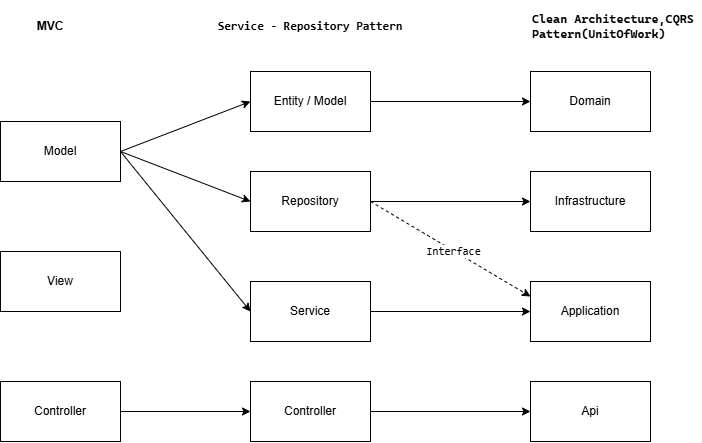

- **`View` tách độc lập:** Dự án tập trung xây dựng Backend Web API (giao tiếp JSON qua `TodoItemDto`), giao diện người dùng thuộc phía Frontend nên không nối vào chuỗi ánh xạ Backend.
- **`Model` (MVC chuẩn) tách làm 3 nhánh:** Trong lý thuyết MVC gốc, `Model` gánh cả dữ liệu, nghiệp vụ và truy vấn DB → tách thành **`Entity / Model`** (→ `Domain`), **`Service`** (→ các Command/Query Handler trong `Application`), và **`Repository`**.
- **`Repository` tách đôi theo nguyên lý đảo ngược phụ thuộc (DIP):** Đường **nét đứt (`Interface`)** đưa hợp đồng `ITodoItemRepository`, `IUnitOfWork` vào `Application`; đường **nét liền** đặt phần thực thi EF Core tại `Infrastructure`.
- **`Controller` giữ nguyên vai trò điều phối mỏng:** `Controller` → `Controller` → **`TodoApp.API`** (`TodoItemController`).

---

## 3. Thiết kế Bảng và Đặc tả Bộ RESTful API

### 3.1. Thiết kế Bảng `dbo.TodoItems` (Database First)

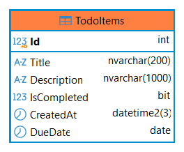

| Cột | Kiểu SQL Server | Kiểu C# | Ràng buộc / Ghi chú |
| :--- | :--- | :--- | :--- |
| `Id` | `int IDENTITY(1,1)` | `int` | Khóa chính tự tăng (`PK_TodoItems`) |
| `Title` | `nvarchar(200) NOT NULL` | `string` | Bắt buộc, chặn chuỗi rỗng/khoảng trắng (`CK_TodoItems_Title_NotBlank`) |
| `Description` | `nvarchar(1000) NULL` | `string?` | Mô tả chi tiết (tùy chọn) |
| `IsCompleted` | `bit NOT NULL` | `bool` | Mặc định `0` (`false` — chưa hoàn thành) |
| `CreatedAt` | `datetime2(3) NOT NULL` | `DateTime` | Mặc định `SYSUTCDATETIME()` (giờ UTC) |
| `DueDate` | `date NULL` | `DateOnly?` | Hạn hoàn thành theo ngày (tùy chọn) |

### 3.2. Đặc tả Bộ RESTful API (`/api/todo-item`)

| Method | Endpoint | Mô tả nghiệp vụ | Handler xử lý | Mã phản hồi |
| :---: | :--- | :--- | :--- | :--- |
| `GET` | `/api/todo-item` | Lấy danh sách toàn bộ công việc (`AsNoTracking`) | `GetTodoItemsHandler` | `200 OK` |
| `POST` | `/api/todo-item` | Tạo mới công việc (`CreateTodoItemCommand`) | `CreateTodoItemCommandHandler` | `201 Created` (`Location`), `400` |
| `GET` | `/api/todo-item/{id}` | Xem chi tiết công việc theo ID | `GetTodoItemByIdHandler` | `200 OK`, `404 Not Found` |
| `PUT` | `/api/todo-item/{id}` | Cập nhật nội dung & trạng thái `IsCompleted` | `UpdateTodoItemCommandHandler` | `200 OK`, `400`, `404 Not Found` |
| `DELETE` | `/api/todo-item/{id}` | Xóa công việc theo ID | `DeleteTodoItemCommandHandler` | `204 No Content`, `404 Not Found` |

---

## 4. Demo Sản phẩm trên Swagger UI

### 4.1. Tổng quan 5 API với Tài liệu XML Comments
Giao diện hiển thị đầy đủ 5 endpoint:

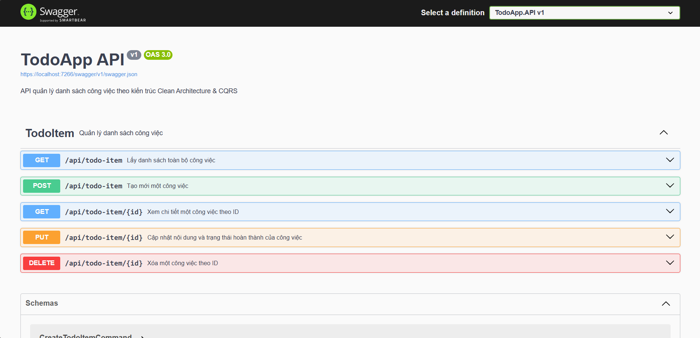

### 4.2. Lấy danh sách toàn bộ công việc (`GET /api/todo-item`)
Trả về mã `200 OK` cùng danh sách JSON các công việc trong `TodoAppDB`:

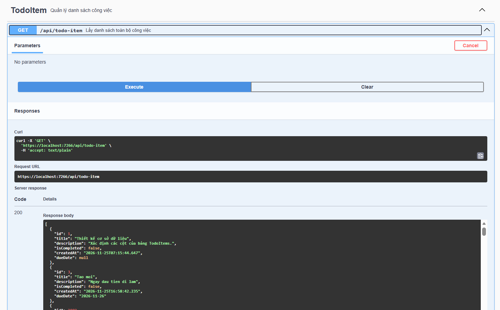

### 4.3. Tạo mới công việc (`POST /api/todo-item`)
Gửi thông tin công việc mới (`"Hom nay lam todo app"`, `dueDate: "2026-11-27"`):

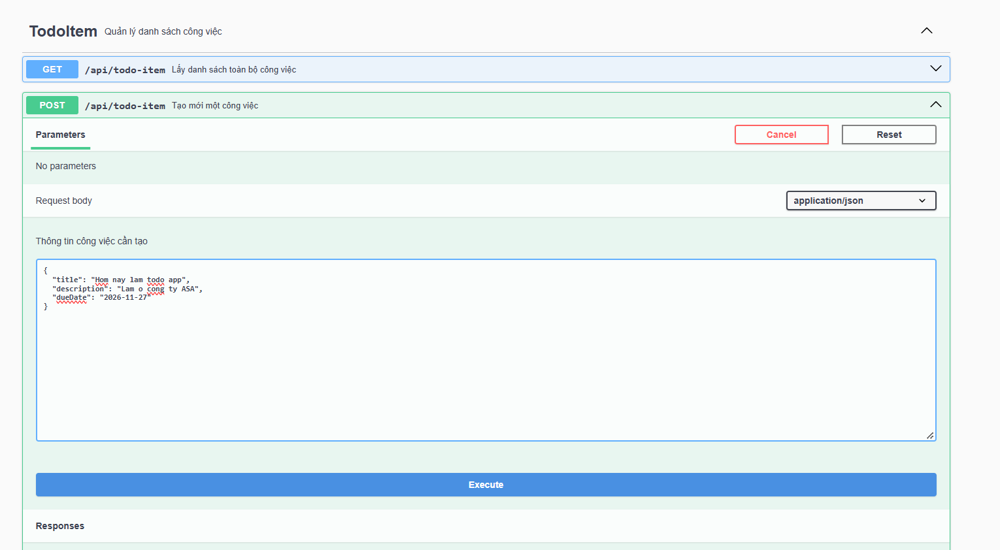

Phản hồi chuẩn `201 Created`, kèm header `location: https://localhost:7266/api/todo-item/2052` và đối tượng `id: 2052`:

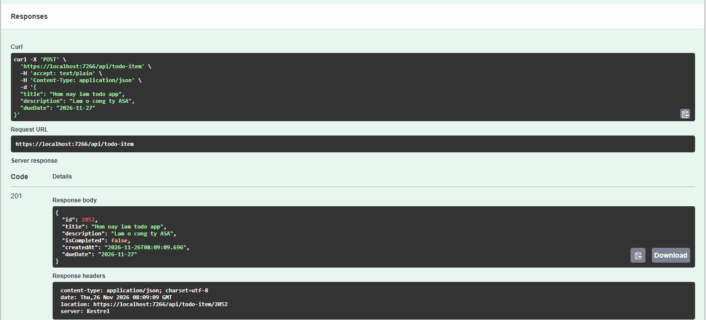

### 4.4. Xem chi tiết theo ID (`GET /api/todo-item/{id}`)
Trường hợp tìm thấy (`id = 1`) — trả về `200 OK`:

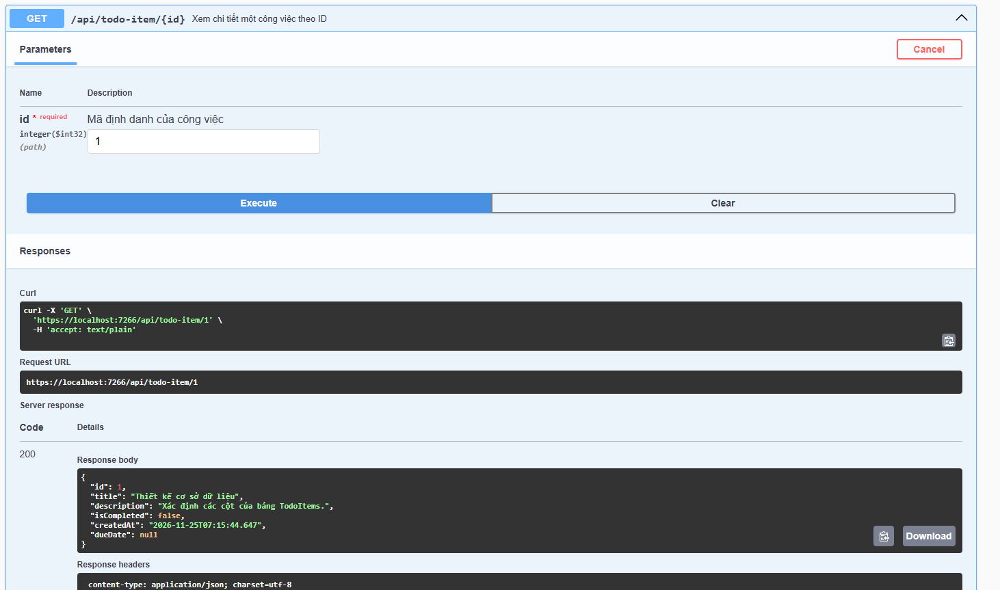

Trường hợp không tồn tại (`id = 0`) — trả về `404 Not Found`:

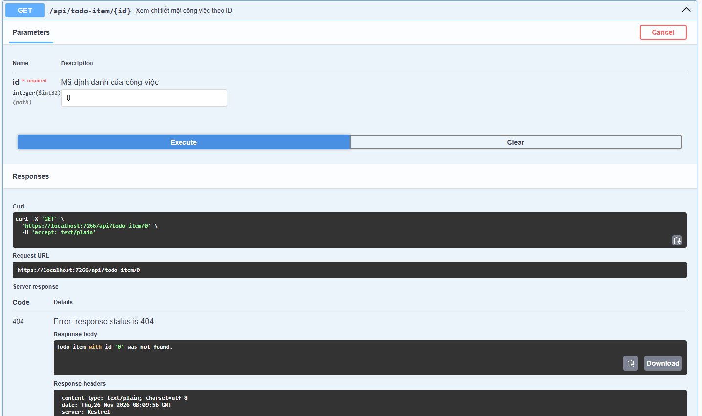

### 4.5. Cập nhật công việc (`PUT /api/todo-item/2052`)
Cập nhật mô tả và đánh dấu hoàn thành (`isCompleted: true`) cho bản ghi `id = 2052`:

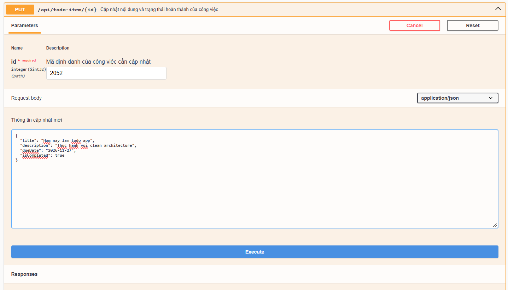

Phản hồi `200 OK` xác nhận dữ liệu mới đã được lưu thành công:

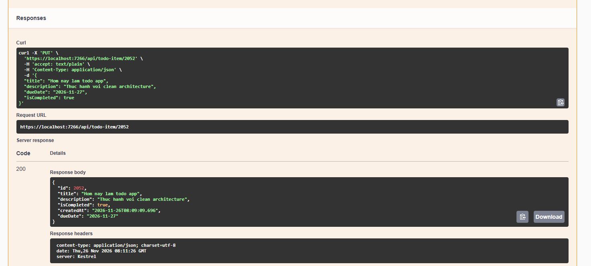

### 4.6. Xóa công việc (`DELETE /api/todo-item/2052`)
Xóa bản ghi `id = 2052` thành công, trả về đúng chuẩn `204 No Content`:

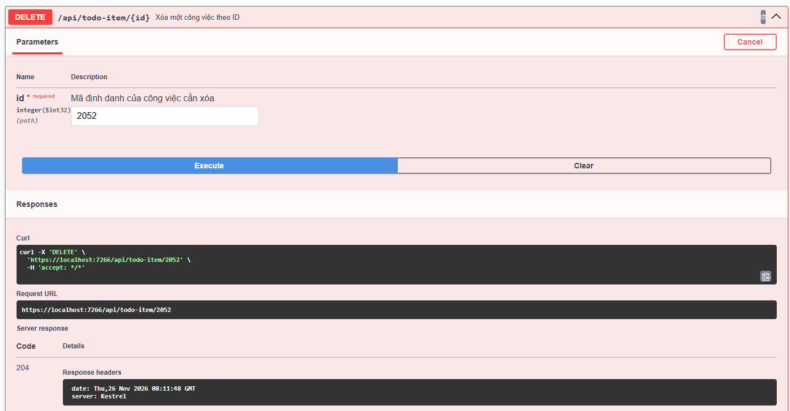
